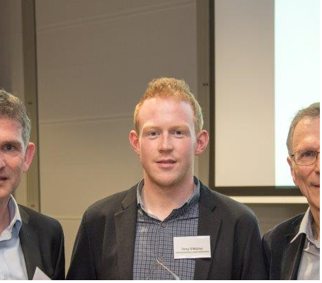

::: {.container style="max-width: 800px; margin: 0 auto;"}

Hi, I'm **Terry O'Malley**. I am an economist and data scientist working in tech.

Prior to jumping to industry, I worked as a research economist at the **Central Bank of Ireland** and did my PhD at **University College Dublin**.

I mainly work on **causal inference** and **econometrics** problems, as well as using microeconomic theory to help guide business decisions around things like selection, pricing and operations.

:::

::: {.container style="max-width: 800px; margin: 2rem auto; text-align: center;"}
{width="300"}
:::

## Research Interests

- Causal Inference & Econometrics
- Microeconomic Theory
- Selection, Pricing & Operations
- Financial Risk Modeling

## Contact & Profiles

::: {.container style="max-width: 800px; margin: 2rem auto;"}
- 📧 [Email](mailto:your.email@example.com)
- 🎓 [Google Scholar](https://scholar.google.com/)
- 📄 [SSRN](https://ssrn.com/)
- 💼 [LinkedIn](https://www.linkedin.com/)
- 🐙 [GitHub](https://github.com/terryomalley)
:::

## Selected Publications

See my [Publications](publications.qmd) page for the full list.

::: {#refs}
:::